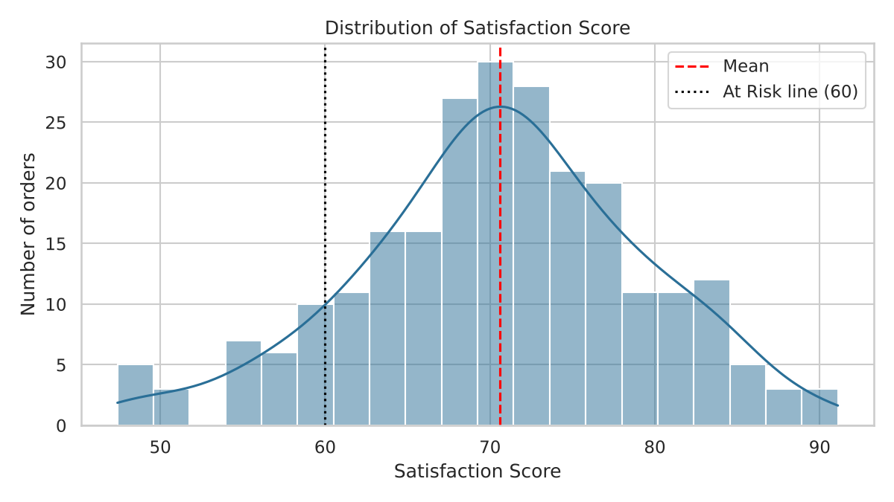
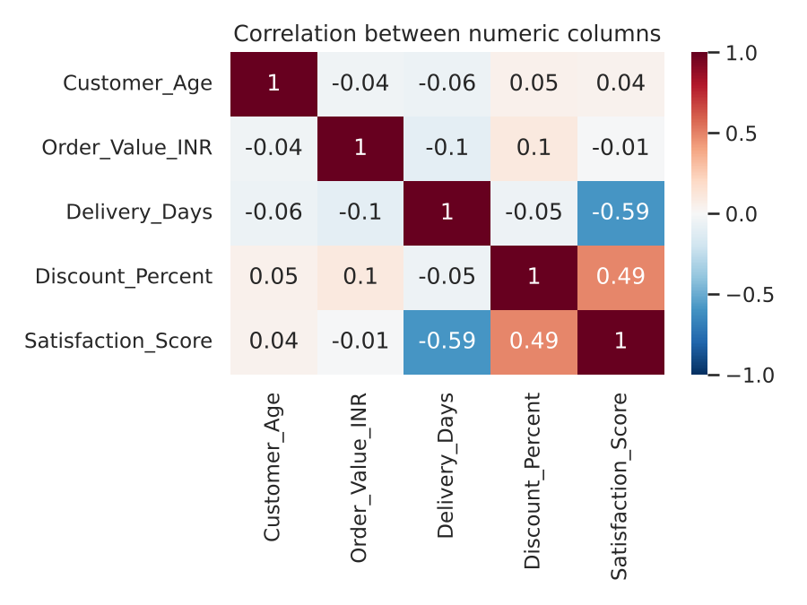
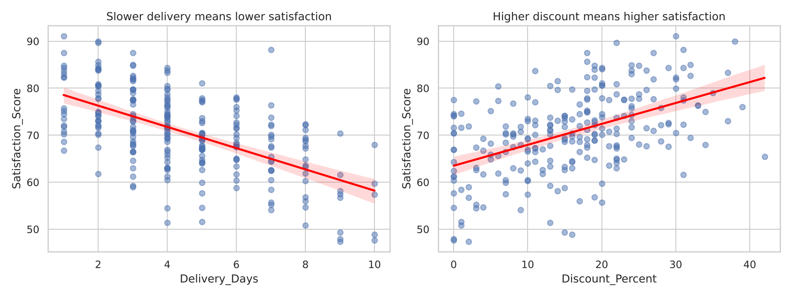
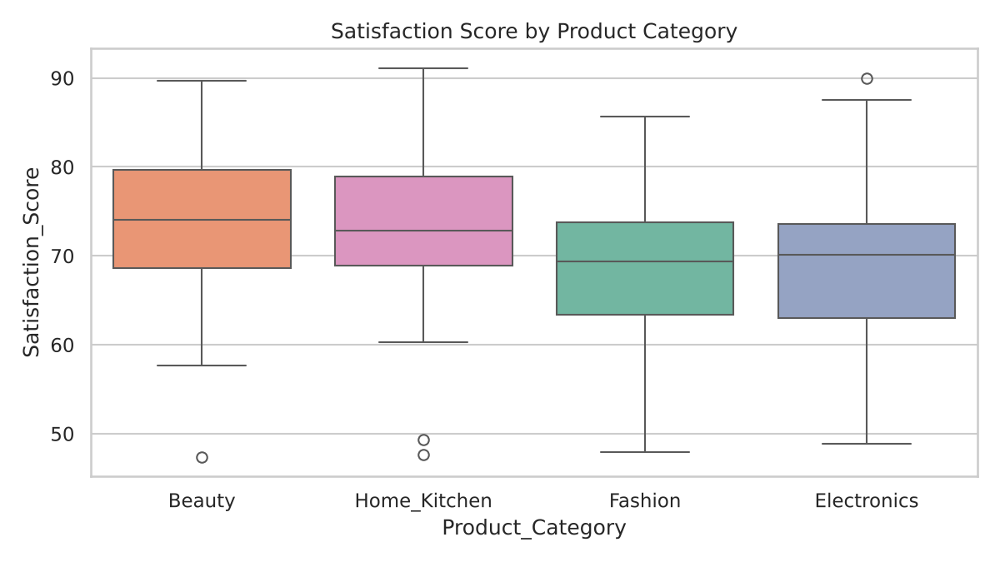
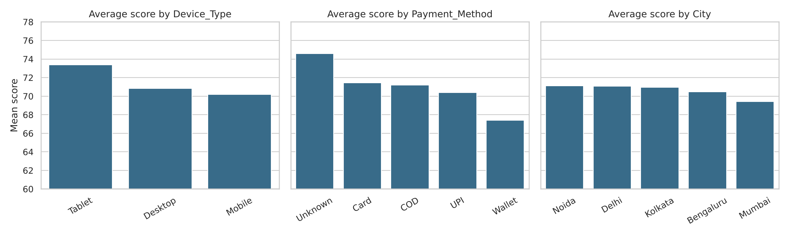
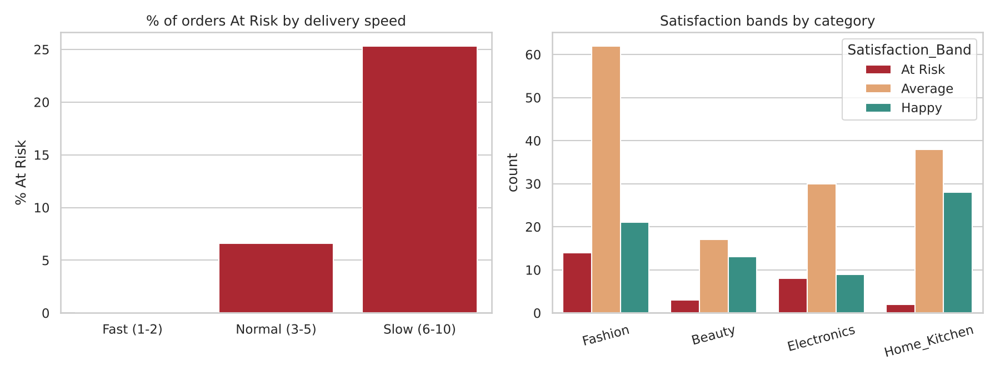
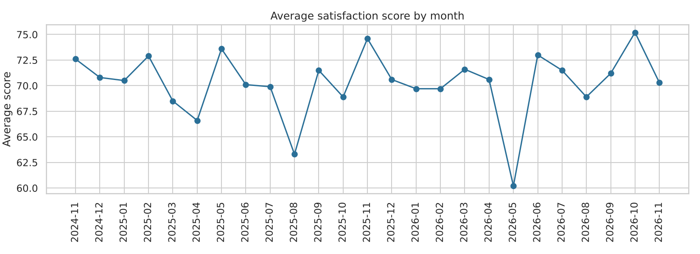

# Online Shopping Orders: Customer Satisfaction Analysis

A beginner data analysis project in Python (pandas, NumPy, matplotlib, seaborn) on a synthetic dataset of Indian online shopping orders.

## Business problem
An e-commerce operations manager sees that some orders get very low satisfaction scores but does not know why. This project finds the main drivers of `Satisfaction_Score` and flags orders that need attention, so the company can protect repeat purchases and reduce complaints.

## Questions
1. What does the satisfaction score look like overall?
2. Do `Delivery_Days` and `Discount_Percent` affect the satisfaction score?
3. Does the score differ by product category, device, payment method and city?
4. Which orders need attention (**At Risk** = score below 60)?

## Data dictionary
| Column | Type | Meaning | Valid values / range |
|---|---|---|---|
| Order_ID | text | Unique order id | O1001 to O1250 |
| Order_Date | date | Date of order (DD-MM-YYYY in raw file) | last ~2 years |
| City | category | Delivery city | Delhi, Mumbai, Bengaluru, Kolkata, Noida |
| Product_Category | category | Product type | Fashion, Electronics, Home_Kitchen, Beauty |
| Payment_Method | category | Payment type | UPI, Card, COD, Wallet |
| Device_Type | category | Device used | Mobile, Desktop, Tablet |
| Customer_Age | number | Age in years | 18 to 60 |
| Order_Value_INR | number | Order amount in rupees | > 0 |
| Delivery_Days | number | Days to deliver | 1 to 10 |
| Discount_Percent | number | Discount given | 0 to 100 |
| Satisfaction_Score | number | **Outcome**: satisfaction | 0 to 100 |

## Project structure
```
online-shopping-analysis/
├── data/raw/online_shopping_data.csv          (original file, not edited)
├── data/processed/online_shopping_data_clean.csv
├── notebooks/online_shopping_analysis.ipynb
├── images/                                    (saved charts)
├── requirements.txt
└── README.md
```

## Steps followed
1. **Load and inspect**: 255 rows, 11 columns; checked `info`, `describe`, missing values, duplicates.
2. **Clean**: removed 5 duplicate rows; standardised city spelling; converted dates (day first); set 2 impossible discounts (250, 135) to missing; dropped 5 rows with no satisfaction score; filled missing age, delivery days and discount with the median; labelled missing payment method "Unknown". Final: 245 rows, 0 missing.
3. **New columns**: `Discount_Amount_INR`, `Satisfaction_Band`, `Delivery_Speed`, `Age_Group`, `Order_Month`.
4. **Analysis**: statistics and 7 charts for the four questions.

## Key findings
- Average satisfaction is **70.6**; **11.0% of orders (27 of 245)** are At Risk (score below 60).
- **Delivery time is the biggest driver** (correlation about -0.59): fast orders average 77.5, slow orders 65.0.
- About **25% of slow orders are At Risk**, versus about 7% for normal and 0% for fast deliveries.
- **Discounts help** (correlation about +0.49): 21%+ discount averages 75.4, 0-10% averages 65.4.
- **Order value and customer age have almost no effect** (about -0.01 and 0.04).
- Beauty (73.2) and Home_Kitchen (73.1) score higher than Fashion (68.9) and Electronics (68.5).
- Device, payment method and city show only small differences.

## Charts








## Recommendations
1. Cut delivery time first; aim for most orders within 5 days, starting with Fashion (slowest, largest category).
2. Alert on orders that pass 6 days and follow up proactively.
3. Offer coupons to customers who had a slow delivery.
4. Investigate quality and returns for Fashion and Electronics.
5. Do not segment service by age or order value.
6. Collect more data on Wallet and Tablet orders before deciding.

## How to run
```
pip install -r requirements.txt
jupyter notebook notebooks/online_shopping_analysis.ipynb
```
*The data is synthetic, so findings show the method, not real market facts.*
